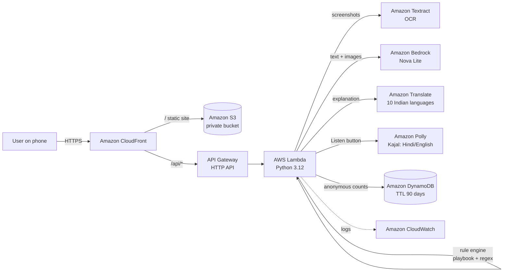

# Nivesh Kavach (निवेश कवच)

**Check an investment offer before you pay. Get first-hour help if you already did.**

In 2025, 77% of the money Indians lost to cyber fraud went to fake investment schemes (I4C / National Cyber Crime Reporting Portal data). These scams run inside WhatsApp/Telegram "stock-tips" groups and fake trading apps, where caller-ID and spam filters can't see them.

Nivesh Kavach lets anyone paste a message or upload screenshots. It tells them in their own language:
- whether it looks like a scam, with the exact words that are red flags,
- **which stage of the scam they are at and what the scammer will do next**,
- whether the payment UPI ID is a SEBI-validated `@valid` ID, and whether a SEBI registration number checks out,
- what to do now, with a one-tap WhatsApp message to warn family. If they already paid, it gives the first-hour steps (1930, cybercrime.gov.in, bank) and a **complaint draft pre-filled from their payment screenshots**.

> Built for the Campus to Cloud Hackathon (Techfest 2026-27, sponsored by AWS). **Start with [NEXT_STEPS.md](NEXT_STEPS.md).**

---

## Architecture



**How one check works**
1. The browser shrinks screenshots (max 1600px JPEG) and sends them with any pasted text.
2. **Textract** reads English text, numbers, UPI IDs, links and transaction IDs from the screenshots.
3. The **rule engine** (`backend/src/rules.py`) looks for about 20 red flags: guaranteed returns, a withdrawal "tax", a non-`@valid` UPI ID, lookalike broker domains, APK links, and so on. It works even if the AI is down, and every flag shows the exact words that triggered it.
4. **Bedrock** gets the text, the screenshots (so it can read Hindi/Marathi), the rule-engine hints and the scam playbook (`playbook.json`). It returns the scam type, the stage, and what the scammer will likely do next as JSON.
5. The two are merged with a **safety-first** rule: the AI can raise the risk level but never lower a rule-based HIGH.
6. **Translate** turns the explanation into the user's language. **Polly** reads it aloud.
7. **DynamoDB** stores only the scam type, risk level, stage and an optional city, which feed the "scams this week" chart. No messages, images, UPI IDs or phone numbers are stored.

## Repo layout
```
backend/
  template.yaml        AWS SAM: Lambda, HTTP API, DynamoDB, S3, CloudFront
  src/app.py           Lambda handler (/api/analyze, /api/speak, /api/trends, /api/health)
  src/analyzer.py      pipeline + merging + complaint draft
  src/rules.py         deterministic red-flag engine
  src/playbook.json    5 Indian investment-scam types with ordered stages
  src/aws.py           Textract / Bedrock / Translate / Polly / DynamoDB wrappers
  src/registry.py      SEBI registration-number lookup
  tests/               pytest (runs without AWS)
frontend/              static mobile-first site (no build step)
samples/samples.json   made-up test messages with expected results
samples/screenshots/   watermarked sample chat screenshots for the demo
eval/labelled.csv      labelled messages (add real ones!) for measuring accuracy
scripts/deploy.sh      one-command deploy
scripts/smoke_test.py  checks the live site and every AWS service
scripts/evaluate.py    accuracy report on eval/labelled.csv (local or live)
scripts/local_server.py run everything on your laptop
scripts/build_registry.py build the SEBI registry CSV from saved SEBI pages
scripts/make_demo_screenshots.py regenerate the sample screenshots
NEXT_STEPS.md          what's left before submission, step by step
DEMO_SCRIPT.md         3-minute demo video script
```

## Run locally (no AWS needed)
```bash
pip install pytest
cd backend && python -m pytest -q && cd ..
MOCK_AWS=1 python scripts/local_server.py     # open http://localhost:8000
```
With `MOCK_AWS=1` only the rule engine runs. Remove it to use your AWS credentials, which turns on Textract, Bedrock, Translate and Polly.

## Deploy to AWS (about 10 minutes)
Prerequisites: AWS account (Free plan), [AWS CLI v2](https://docs.aws.amazon.com/cli/latest/userguide/getting-started-install.html), [AWS SAM CLI](https://docs.aws.amazon.com/serverless-application-model/latest/developerguide/install-sam-cli.html), `aws configure` done.

1. **Budget alert first:** Billing → Budgets → create a $10 monthly budget with email alerts.
2. **Test Bedrock:** in the Bedrock console (region `us-east-1`), open the playground and send a message to **Amazon Nova Lite**. If you get a quota or access error on the Free plan, upgrade the account to the Paid plan (your credits still apply) and try again.
3. **Deploy:**
   ```bash
   ./scripts/deploy.sh nivesh-kavach us-east-1
   ```
   It prints the **Live URL**. Open `<Live URL>/api/health` to confirm.
4. (Optional) **Load the SEBI register:** save the Investment Adviser, Research Analyst and Stock Broker result pages from https://www.sebi.gov.in/intermediaries.html into a folder, then run `python scripts/build_registry.py <folder>` and deploy again.

To use a different model, run `sam deploy --parameter-overrides BedrockModelId=<model-or-inference-profile-id>`.

## Honest limits
- It gives guidance, not a guarantee. A "low risk" result does not prove something is safe.
- Accuracy so far has only been measured on made-up examples (`eval/labelled.csv`, all marked `synthetic`), which the rules were also tuned on. Add real, anonymised messages and run `scripts/evaluate.py` before quoting a number.
- Audio is Hindi and Indian English only, because those are the Indian languages Polly's Kajal voice supports.
- The SEBI registry check is only as fresh as the CSV you load. The app always links to SEBI's own tools.
